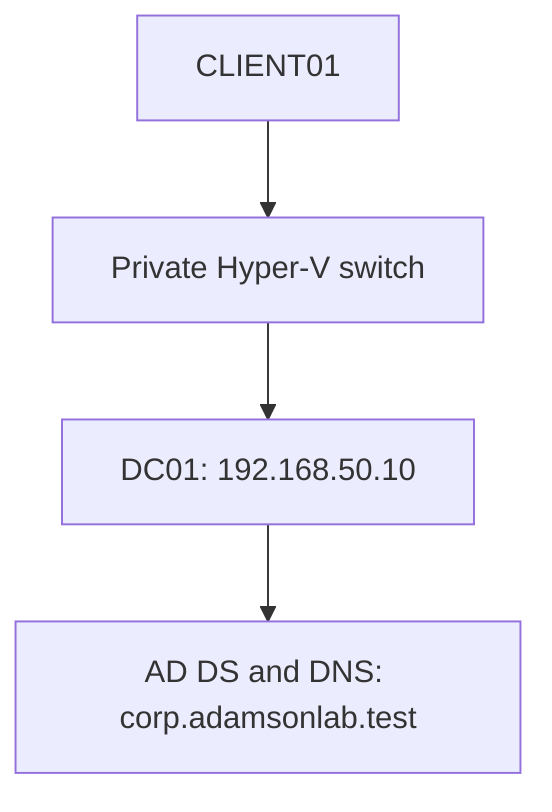

# Enterprise Identity Lab

An isolated Windows Server 2022 and Windows 11 lab for identity administration. Status: starter configuration, not yet deployed or validated.

## Architecture

## Setup
1. Create a private Hyper-V switch and two VMs using licensed or evaluation Windows media.
2. Install Windows Server 2022 Desktop Experience on DC01. Set its IPv4 address to 192.168.50.10/24 and DNS to 192.168.50.10. No gateway is needed for this isolated lab.
3. Run scripts/01-domain.ps1 as administrator on the fresh server. Enter a unique DSRM password when prompted. The server restarts.
4. Sign in as domain administrator and run scripts/02-organizational-units.ps1.
5. Set CLIENT01 to 192.168.50.20/24 with DNS 192.168.50.10. Use Windows Pro or Enterprise and join corp.adamsonlab.test through System Properties.
6. Run scripts/03-validation.ps1 on DC01 and record actual results in TESTING.md.

DHCP, GPO hardening and user provisioning are subsequent lab milestones, not implemented in this starter. Never upload credentials or real employer data.
