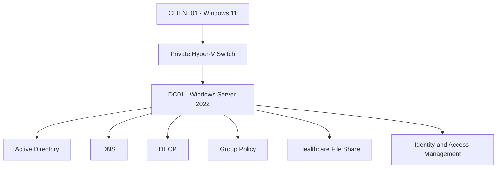

# Enterprise Identity & Infrastructure Lab

## Project Overview

A hands-on enterprise IT infrastructure and cybersecurity lab built using Windows Server 2022, Windows 11 and Microsoft Hyper-V.

This project simulates a corporate environment with multiple departments, centralized identity management, network services, role-based access control and endpoint security.

**Project Status:** Deployed and partially validated.

## Technologies Used

- Windows Server 2022
- Windows 11
- Microsoft Hyper-V
- Active Directory Domain Services
- DNS and DHCP
- Group Policy Management
- PowerShell
- NTFS and SMB Permissions
- Microsoft Defender Antivirus
- Windows Defender Firewall
- Windows Security Auditing

## Infrastructure Architecture

## Network Configuration

| Component | Configuration |
|---|---|
| Domain | corp.adamsonlab.test |
| Domain Controller | DC01 |
| Server IP | 192.168.50.10 |
| Client | CLIENT01 |
| Client DHCP IP | 192.168.50.100 |
| Subnet | 192.168.50.0/24 |
| DHCP Range | 192.168.50.100 - 192.168.50.200 |
| DHCP Lease | 8 days |
| DNS Server | 192.168.50.10 |
| Virtual Switch | Corp-Lab-Switch |

## Enterprise Organizational Structure

The Active Directory environment includes the following organizational units:

- IT
- Cybersecurity
- Healthcare
- Human Resources
- Finance
- Management
- Workstations
- Servers
- Security Groups
- Service Accounts

## Identity and Access Management

- Created six simulated employee accounts.
- Created eight global security groups.
- Organized employee accounts by department.
- Joined a Windows 11 workstation to the corporate domain.
- Verified domain user authentication.
- Implemented role-based access control.
- Configured departmental file sharing using NTFS and SMB permissions.

## Healthcare Access Security

A restricted Healthcare network share was created to demonstrate least privilege and departmental access control.

| Test | Result |
|---|---|
| Healthcare employee access | Passed |
| Authorized file creation | Passed |
| Unauthorized Finance employee access | Denied as expected |

## Network Services

- Installed and configured Active Directory Domain Services.
- Configured and validated DNS.
- Installed and authorized a DHCP server.
- Created an active DHCP scope.
- Verified automatic IP address assignment.
- Confirmed active DHCP client leases.
- Troubleshot network connectivity and firewall restrictions.

## Group Policy and Security Hardening

Configured domain password policies and a dedicated Enterprise Workstation Security GPO.

| Security Control | Configuration |
|---|---|
| Minimum password length | 14 characters |
| Password complexity | Enabled |
| Password history | 24 passwords |
| Minimum password age | 1 day |
| Account lockout threshold | 5 attempts |
| Account lockout duration | 15 minutes |
| Reversible password encryption | Disabled |
| Automatic screen lock | 10 minutes |
| Microsoft Defender | Enabled |
| Real-time protection | Enabled |
| Behavior monitoring policy | Enabled |
| Logon auditing | Success and Failure |
| Logoff auditing | Success |
| Account lockout auditing | Failure |
| Special logon auditing | Success |

## Validation Results

- Active Directory domain and forest verified.
- DNS diagnostic tests passed.
- Client-to-server connectivity verified.
- Domain authentication successful.
- Authorized and unauthorized file access tested.
- DHCP address assignment verified.
- Workstation Group Policy application verified.
- Domain and Private firewall profiles verified.
- Defender real-time protection verified.
- Logon and logoff audit settings verified.

## Remaining Validation

- Actual account lockout behavior.
- Automatic screen lock behavior.
- Public firewall profile status.
- Guest account security.
- Security event generation and Event Viewer analysis.

## PowerShell Automation

The repository includes starter PowerShell scripts for domain deployment, organizational unit creation and infrastructure validation.

Additional configuration was performed through PowerShell and Windows administrative tools during the lab.

## Project Evidence

Screenshots documenting the infrastructure deployment, configuration and security validation are available below.

[View Project Screenshots](./screenshots/)

[View Testing Documentation](./TESTING.md)

## Skills Demonstrated

- Systems Administration
- Active Directory Administration
- Identity and Access Management
- Network Administration
- IT Infrastructure
- Endpoint Security
- Group Policy Management
- PowerShell
- Healthcare IT Access Controls
- Technical Troubleshooting
- Security Configuration and Validation

## Future Improvements

- Windows Event Forwarding
- SIEM Integration
- Backup and Disaster Recovery
- Automated User Provisioning
- Microsoft Entra ID Integration

## Author

Adamson Ahmed

IT Support | Systems Administration | Cloud Infrastructure | Cybersecurity | Healthcare IT

## Disclaimer

This project was developed in an isolated personal lab for educational and professional portfolio purposes. All employee accounts and departmental data are simulated.
